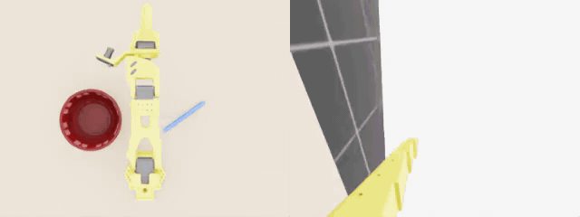

# SO-101 pen-in-bowl (Isaac Lab + Inspect Robots)



An Isaac Lab task where an SO-101 arm puts a pen into a bowl, a scripted inverse-kinematics
pick-and-place baseline, and the [Inspect Robots](https://github.com/robocurve/inspect-robots)
plugins that let you run, score, and replay it from the `inspect-robots` CLI.

| Overhead camera | Wrist camera |
|---|---|
| [media/pen-layout-0-e0_overhead.mp4](media/pen-layout-0-e0_overhead.mp4) | [media/pen-layout-0-e0_wrist.mp4](media/pen-layout-0-e0_wrist.mp4) |

These are `inspect-robots video` renders of one successful trial (the GIF above is the two side by side). Its eval log is
[media/eval_log_example.json](media/eval_log_example.json).

The scripted baseline scores about 8/10 on `-T scenes=10`. The usual failures are the opening jaw
flicking the pen out of the bowl, or the 14 cm pen coming to rest propped on the rim.

## Built with Inspect Robots

[](https://github.com/robocurve/inspect-robots)

The evaluation in this repo runs on [Inspect Robots](https://github.com/robocurve/inspect-robots)
by Robocurve. The task, policy and embodiment here are Inspect Robots plugins, and
Inspect Robots handles the rest:
- the rollout loop
- the safety guardrails
- scoring (`success_at_end`, `episode_length`)
- eval logs, frame storage and the HTML/video replays

The Isaac Sim connection builds on its
[`inspect-robots-isaacsim`](https://github.com/robocurve/inspect-robots/tree/main/plugins/inspect-robots-isaacsim) plugin.

If you use this work, please also cite Inspect Robots:

```bibtex
@software{inspect_robots,
  title  = {Inspect Robots: The open-source evaluation framework for physical AI},
  author = {{Robocurve}},
  url    = {https://github.com/robocurve/inspect-robots},
  note   = {MIT License}
}
```

## Files

| File | What it is |
|---|---|
| `pen_bowl_env.py` | Isaac Lab `DirectRLEnv`, gym id `Isaac-SO101-PenBowl-v0`. Table, YCB bowl (fixed), hexagonal pen (random position/yaw per seed), overhead + wrist `TiledCamera`s (240x320). Action: 5 absolute joint targets + binary gripper (>=0.5 closes). Success: pen at rest inside the bowl with the gripper open. |
| `so101_cfg.py` | SO-101 articulation config (USD path, actuators). |
| `so101_kinematics.py` | NumPy FK / damped-least-squares IK read from the SO-ARM100 URDF. No Isaac dependency. |
| `ik_policy.py` | `IKPickPlacePolicy`: an oracle baseline that uses privileged pen/bowl state. It plans the pick from the first observation, then plans the place after lifting, aiming the pen's measured centre at the bowl. |
| `run_eval.py` | `SO101PenBowlEmbodiment` (subclass of the `inspect-robots-isaacsim` adapter: privileged state, cameras, joint-limit action bounds) and a plain-Python eval entry point. |
| `so101_inspect.py` + `pyproject.toml` | Inspect Robots entry points: policy `so101_ik`, embodiment `so101_pen_bowl`, task `so101-pen-in-bowl` (`-T scenes=N`). |
| `ik_eval.sh` | One-command run + replay-page render; `--gui` shows the sim live on the noVNC desktop. |
| `preview_scene.py` | Standalone GUI preview of the scene layout. Note: it still uses a round pen. |
| `scripts/start_desktop.sh`, `scripts/run_isaaclab_gui.sh` | Xvfb + xfce + x11vnc + noVNC desktop (port 6080) for watching Isaac on a headless GPU box. |
| `so101_real.py` | Embodiment `so101_real`: the physical SO-101 through [`inspect-robots-so101`](https://github.com/robocurve/inspect-robots-so101) (LeRobot driver). It has the wrist camera, joint limits taken from the LeRobot calibration (minus 5°), and a 3°/step slew limit. |
| `real_notes.md`, `real_eval.sh` | Robot notes given to the LLM policy (`prior_learnings`), and the one-command real-arm run with operator grading. |
| `debug_grasp.py`, `debug_pen.py` | Diagnostics: FK vs Isaac body poses during a grasp, and pen drift with the arm held still. |

## Setup

Tested with Isaac Sim 5.1, Isaac Lab 2.3.2, an L40S, and the Isaac Lab venv at `/data/env_isaaclab`.

1. Get the SO-101 URDFs from [SO-ARM100](https://github.com/TheRobotStudio/SO-ARM100)
   (`Simulation/SO101/`) into `/data/so101/`. Convert the camera variant to USD:
   ```bash
   python /data/IsaacLab/scripts/tools/convert_urdf.py \
       /data/so101/so101_new_calib_camera.urdf /data/so101/usd_cam/so101_new_calib_camera.usd --fix-base --headless
   ```
   You can override the paths with the `SO101_URDF` (kinematics) and `SO101_USD` (robot asset) environment variables.
2. Install Inspect Robots, the Isaac adapter, and this package into the Isaac venv:
   ```bash
   uv pip install -e <inspect-robots> -e <inspect-robots>/plugins/inspect-robots-isaacsim
   uv pip install --no-deps -e .
   inspect-robots list          # shows so101_ik, so101_pen_bowl, so101-pen-in-bowl
   ```
3. Install `ffmpeg`. It's needed for the MP4 replays.

## Run, watch, replay

```bash
./ik_eval.sh -T scenes=5            # headless
./ik_eval.sh --gui -T scenes=5      # also live on the noVNC desktop: http://localhost:6080/vnc.html
```
`ik_eval.sh` wraps:
```bash
inspect-robots run --task so101-pen-in-bowl --policy so101_ik --embodiment so101_pen_bowl \
    --store-frames --no-prompt --log-dir logs
```
To replay runs in the browser, serve the reports and open http://localhost:8300 (tunnel ports 8300/6080 over SSH from a remote box):
```bash
inspect-robots view logs --serve --port 8300
inspect-robots inspect logs/<run>.json       # scores in the terminal
inspect-robots video logs/<run>.json         # one MP4 per camera per trial
```

## Real SO-101

The same evaluation runs on a physical SO-101 with a wrist camera, here driven by an LLM
policy (`openai/gpt-6-astra` over OpenRouter, via `inspect-robots-agent`). A real setup has no
privileged object positions, so the model works only from the wrist camera. An operator grades
each trial.

Setup, in the LeRobot env (Python ≥ 3.12, LeRobot ≥ 0.5):
1. Calibrate the arm once with LeRobot:
   ```bash
   lerobot-calibrate --robot.type=so101_follower --robot.port=/dev/ttyACM0 --robot.id=my_follower
   ```
2. Install the packages (all editable from local clones):
   ```bash
   pip install -e <inspect-robots> -e <inspect-robots-so101> -e <inspect-robots>/plugins/inspect-robots-agent
   pip install --no-deps -e .
   ```
3. Give your user access to the arm and the camera (`dialout` and `video` groups).
   Put `OPENROUTER_API_KEY=...` in `./.env`; it's gitignored and auto-loaded by `inspect-robots`.

Then, in an interactive terminal:
```bash
./real_eval.sh        # confirm the scene is ready, Esc ends a trial, then grade y/n/partial
```
`-E port=… -E camera=/dev/video1 -E robot_id=…` override the defaults in `so101_real.py`.

First physical trial (2026-10-12): the model gave up after about 1,200 steps and was graded 0.
The bowl repeatedly blocked the wrist camera's view of the pen, and one grasp caught the bowl
rim instead of the pen. The operator's note was that the setup itself was poor. The log and
replay are on the [`eval-logs`](../../tree/eval-logs) branch.

## Notes

- PhysX's analytic round cylinder kept rolling on its own (~1 cm/s with no contact), so the pen
  is a 6-sided convex-hull mesh, 11 mm across the flats.
- The URDF's `gripper_frame_link` sits on the fixed jaw's inner face. The IK tool point is the middle
  of the jaw gap instead (`TCP_IN_GRIPPER_LINK` in `so101_kinematics.py`).
- `SimulationApp.close()` ends the process, so the embodiment defers it to interpreter exit;
  otherwise the CLI's results summary never prints.
